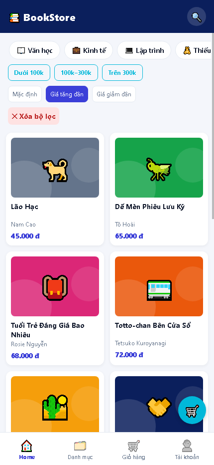

# Trả lời câu hỏi bổ sung — Buổi 7

## 1. Cấu trúc điều hướng
BookDetail được đăng ký trong Native Stack nên màn chi tiết phủ lên cả Tab Bar và có nút quay lại. Nếu đăng ký trong Bottom Tab, chi tiết sẽ trở thành một tab riêng, vẫn hiện thanh tab và không tự có nút quay lại như Stack.

## 2. Redux và useMemo
Redux Toolkit dùng Immer để reducer thao tác trên bản nháp, sau đó tạo state mới bất biến; `state.items.push(...)` không sửa trực tiếp state gốc. Bỏ `useMemo` không làm thay đổi tổng số lượng hoặc tổng tiền, nhưng các phép tính sẽ chạy lại mỗi lần component render. `useMemo` chỉ tối ưu tính toán, không quyết định kết quả đúng hay sai.

## 3. Promise.all
Nếu API danh mục lỗi còn API sách thành công, `Promise.all` vẫn bị reject nên Home hiện ErrorView và nút Thử lại. Có thể dùng `Promise.allSettled` để lấy sách khi kết quả sách có trạng thái `fulfilled`, đồng thời báo lỗi riêng cho danh mục. Đổi lại cần xử lý từng kết quả và có thể phải hiển thị giao diện thiếu danh mục; bài hiện tại giữ `Promise.all` theo yêu cầu BT7.5.

## 4. Debounce
Đặt `setTimeout` trong `onChangeText` mà không hủy timer cũ sẽ tạo một timer cho mỗi phím, khiến mọi lần gõ vẫn kích hoạt lọc sau thời gian chờ. Hàm dọn dẹp của `useEffect` hủy timer trước khi từ khóa thay đổi tiếp hoặc component unmount. Vì vậy chỉ giá trị sau khi người dùng ngừng gõ 400 ms mới được dùng để lọc.

## 5. Sắp xếp giá
Home đã có ba tùy chọn Mặc định, Giá tăng dần và Giá giảm dần. Sắp xếp chạy sau bộ lọc trên bản sao mảng nên không thay đổi dữ liệu sách gốc và dùng chung được với tìm kiếm, danh mục, khoảng giá.

```tsx
const [sort, setSort] = useState<"asc" | "desc" | null>(null);
const visibleBooks = useMemo(() => {
  const filtered = filterBooks(books, {
    keyword: debouncedKeyword, categoryId, priceRange,
  });
  return sort === null ? filtered : [...filtered].sort((a, b) =>
    sort === "asc" ? a.price - b.price : b.price - a.price);
}, [books, debouncedKeyword, categoryId, priceRange, sort]);
```

## Thử thách C1 — Adapter state
Nút ♡/♥ trong BookDetail dùng `useWishlist()` thay vì đọc Redux trực tiếp. Khi đổi thư viện state, chỉ cần giữ nguyên giao diện trả về của hook (`isFavorite`, `toggle`) và thay phần triển khai hook; JSX không phải sửa.

## Ảnh minh chứng



Bộ ảnh các màn hình: xem [docs/KiemThu.md](docs/KiemThu.md).
